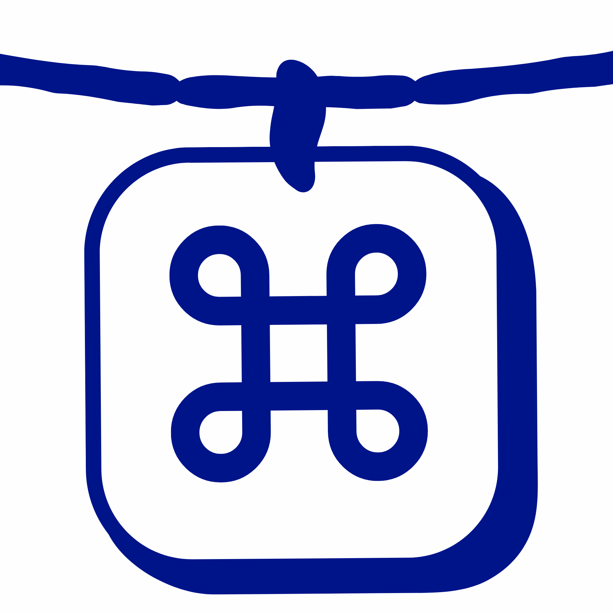

<p align="center"></p>

<h1 align="center">Picshoo</h1>

<p align="center">截图挂在屏幕顶部的晾衣绳上，要标注时长按打开 capcap 的编辑器。</p>

Picshoo 由两个 MIT 开源项目拼接而成，界面用 Woo 的风格：

- [capcap](https://github.com/realskyrin/capcap)：双击 ⌘ 截图、长截图、标注编辑器、美化、钉图、OCR 等。
- [Tendedero](https://github.com/alejandrobujan/tendedero)：截图挂在屏幕顶部的绳子上，单击复制、拖出发送、点叉丢弃。

## 用法

| 操作 | 效果 |
|:--|:--|
| 双击 ⌘ 并框选 | 截图直接挂上绳子，同时复制到剪贴板 |
| 系统截图 ⌘⇧3/4/5 | 打开「接管截图」后同样挂上绳子 |
| 鼠标停在菜单栏中间 | 绳子滑下来 |
| 单击图片 | 复制 |
| **长按图片** | 用 capcap 的编辑器标注，确认后写回这张图 |
| 拖到 app 里 / 文件夹里 | 发送一份 / 保存并取下 |
| 点叉，或拖进废纸篓 | 丢弃 |
| ⌃⌥T | 显示或隐藏绳子 |

绳子的设置在菜单栏图标的「晾衣绳」子菜单里，包括「截图后直接挂上（跳过编辑）」开关。

## 安装

从 [Releases](../../releases/latest) 下载 `Picshoo.zip`，解压后把 `Picshoo.app` 拖进「应用程序」。

这个 app 没有经过 Apple 公证，第一次打开前需要运行：

```bash
xattr -dr com.apple.quarantine /Applications/Picshoo.app
```

打开后，按提示授予「屏幕录制」和「辅助功能」权限，再点「启动」。

需要 macOS 14 或更高版本。

## 从源码构建

```bash
bash scripts/bundle.sh            # 输出 build/Picshoo.app
bash scripts/rebuild-and-open.sh  # 编译、安装到 /Applications 并打开
```

图标（App 和菜单栏）都由 `menu.png` 生成：

```bash
swift scripts/make-icons.swift . && iconutil -c icns build/AppIcon.iconset -o Resources/AppIcon.icns
```

## 许可

代码遵循 MIT 许可，详见 `LICENSE`（capcap）、`ThirdParty/Tendedero/LICENSE` 和 `NOTICE.md`。界面字体 Product Sans 属于 Google，不在 MIT 许可范围内。
